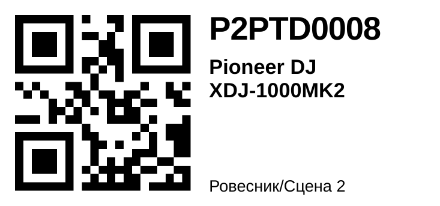

# Telegram-бот для InvenTree

Сотрудник фотографирует прибор, бот распознаёт производителя, модель и серийный номер, находит или создаёт карточку в InvenTree, присваивает внутренний номер `P2PTD0001`, прикладывает фото и присылает QR-этикетку. От человека требуется сфотографировать и нажать «Сохранить».

## Интерфейс: всё кнопками

Главное меню всегда внизу экрана:

```
[ ➕ Добавить прибор ] [ 🔎 Найти   ]
[ 📍 Место           ] [ 👤 Профиль ]
[ ❓ Помощь          ] [ 📜 Журнал  ]   ← журнал только у администраторов
```

До входа в меню две кнопки: «🔑 Войти» и «❓ Помощь». Команды `/add`, `/find`, `/place`, `/profile`, `/cancel` тоже работают, но нужны только по привычке. В каждом шаге есть кнопка «✖️ Отмена» или «⬅️ Назад».

### Добавление прибора

```
➕ Добавить прибор
 └ место уже выбрано раньше → сразу «Пришлите фото»   (иначе: заведение → место кнопками)
 └ 1–3 фото: шильдик крупно и общий вид (файлом мелкий текст читается лучше)
     фото скачиваются и обрабатываются сразу, пока снимаете следующее
 └ [🔍 Распознать (2 фото)]
 └ карточка:
      Pioneer DJ XDJ-1000MK2
      S/N: VJXK012345 ✓ совпал со штрихкодом
      Категория: DJ-оборудование / Проигрыватели
      Место: Пешка / Диджейка
      Из райдера: здесь 2 шт. не проверено, одна будет сверена
      [✅ Сохранить] [✏️ Исправить] [🗂 Категория — для новой модели] [✖️ Отмена]
 └ ✅ → номер P2PTD0008, фото во вложениях, этикетка (PDF из InvenTree) с кнопкой «✏️ Изменить»
 └ «Следующий прибор? Присылайте фото» — место запомнено
```

«✏️ Исправить» присылает шаблон `Производитель: … / Модель: … / S/N: …`. Его нужно скопировать, поправить и отправить обратно.

### Поиск

«🔎 Найти» или просто сообщение без кнопок: номер P2PTD, заводской серийник или фото QR-этикетки. Бот показывает модель, место, статус, последнюю заметку и ссылку на позицию в InvenTree.

### Правка позиции

Под каждой найденной позицией (и под этикеткой после сохранения, кнопка «✏️ Изменить») есть кнопки:

```
[ 📍 Переместить ] [ 🔧 Статус  ]
[ 🏷 Заводской S/N ] [ 📝 Заметка ]
[ 📷 Фото ] [ 🖨 Этикетка ]
[ 🗑 Удалить ]
```

* **Переместить** — заведение → место. Перемещение записывается в историю позиции в InvenTree.
* **Статус** — OK, Требует внимания, Повреждено, Потеряно, Уничтожено.
* **Заводской S/N** — исправить поле Batch; «-» очищает. Тот же S/N у другого прибора этой модели бот не даст поставить.
* **Заметка** — добавляется к прежним с датой и именем, старые не стираются.
* **Фото** — каждое присланное фото сразу прикладывается к позиции.
* **Этикетка** — перепечатать (только у позиций с номером P2PTD).
* **Удалить** — с подтверждением, для ошибочно заведённых. Нужно право Stock Items: Delete; списанный прибор лучше пометить статусом «Уничтожено».

Каждое действие пишется в журнал.

## Распознавание

1. **Штрихкоды** (`zxing-cpp`) читаются точно, без угадывания. Ими проверяется серийник.
2. **Модель с компьютерным зрением** возвращает строго JSON: производитель, модель, серийник, категория из нашего дерева, лучшее фото для карточки, уверенность. Два движка:
   * **Claude API** (`claude-opus-5-5`, effort `low` — быстрее; если на ваших фото будет ошибаться, поднимем);
   * **модель olegovic-llm** на вашем ПК (см. ниже) или любой OpenAI-совместимый сервер.

   Можно включить цепочку `olegovic,claude`: сначала своя модель, при ошибке или недоступности — Claude.
3. **Подтверждение человеком.** Без «Сохранить» в InvenTree ничего не пишется. Фото шильдика всегда остаётся во вложениях.

### Модель olegovic-llm (своя, на ПК)

На ПК уже работает olegovic-llm: llama-swap на `127.0.0.1:8080` (или Ollama на `11434`) с моделью, которая видит изображения (по умолчанию `qwen3.6-35b-a3b`). Бот p2ptd запускается **на этом же ПК** и ходит в тот же сервер. Туннель не нужен, код olegovic не копируется.

`BOT_RECOGNIZER=olegovic` — бот читает `~/.config/olegovic/config.toml` (только его, не `secrets.env`) и берёт оттуда:

* адрес сервера моделей (`llm.base_url`);
* модель роли **vision**, а если она пустая — **smart**. Это та же модель, которой olegovic читает фото, поэтому llama-swap не перезагружает модели между двумя ботами;
* настройку think этой модели из `[llm.think]`. Если там ничего не задано, размышления для распознавания выключены: прочитать шильдик они не помогают, а ответ с ними медленнее и может оборваться. Включить: `LOCAL_LLM_THINK=true`.

При старте бот проверяет, что сервер отвечает и модель на нём есть. Если нет, в логе будет предупреждение.

`BOT_RECOGNIZER=olegovic,claude` — если ПК занят тяжёлой задачей или модель не ответила, распознаёт Claude (нужен `ANTHROPIC_API_KEY`).

Небольшие локальные модели чаще ошибаются в серийниках, чем Claude. Сверка со штрихкодом и подтверждение человеком страхуют, но стоит прогнать 20–30 реальных фото шильдиков.

Подойдёт и любой другой OpenAI-совместимый сервер с vision-моделью (LM Studio, vLLM): `BOT_RECOGNIZER=local` и `LOCAL_LLM_URL` / `LOCAL_LLM_MODEL`.

## Внутренние номера

* `P2PTD0001` — сквозной номер, не зависит от заведения. Пишется в поле **Serial** и печатается на этикетке. Префикс и число цифр: `BOT_SERIAL_PREFIX`, `BOT_SERIAL_DIGITS`.
* Старые номера `P2PTD-00008` бот понимает: учитывает их при выдаче следующего и находит при любом написании. Перевести их в новый формат: `python renumber_serials.py --dry-run`, затем без `--dry-run`. QR на наклеенных этикетках продолжают работать: в них зашита позиция, а не текст номера.

## Этикетки

Этикетки делает **InvenTree** по шаблону «P2PTD 62x29» (файл `labels/p2ptd_stockitem.html`, ставится скриптом `install_label_template.py`):



* **Из InvenTree:** выберите одну или несколько позиций (или откройте место) → «Печать этикеток» (Print labels) → шаблон «P2PTD 62x29». Получится PDF, а если в InvenTree подключён плагин принтера, этикетка уйдёт сразу на принтер.
* **Из бота:** после сохранения и по кнопке «🖨 Этикетка» бот просит InvenTree отрисовать этикетку по этому же шаблону и присылает PDF. Если шаблона нет или InvenTree не справился за 30 секунд, бот рисует PNG сам, в том же виде, и пишет причину в лог.
* **QR:** InvenTree по умолчанию кодирует позицию коротко (`INV-SI42`), бот рисует `{"stockitem": 42}`. Сканер InvenTree, мобильное приложение и бот понимают оба варианта.
* Номер, модель и место подгоняются под размер: длинное название обрезается на трёх строках, длинное место — многоточием.
* Другой размер ленты: `python install_label_template.py --width 50 --height 25 --name "P2PTD 50x25"` и то же имя в `BOT_LABEL_TEMPLATE`. Пустой `BOT_LABEL_TEMPLATE` — этикетки рисует только бот.
* Номер выдаёт бот под блокировкой. Последний выданный номер он помнит и не выкачивает каждый раз весь склад. Если номер оказался занят (его ввели вручную), бот сверяется с InvenTree и берёт следующий.
* В InvenTree включите **«Серийные номера уникальны глобально»** (Settings → Parts → Serial Numbers).
* **Заводской S/N хранится в поле Batch.** Оно видно в таблицах и в мобильном приложении, по нему работает поиск. Повторно завести прибор с тем же S/N той же модели бот не даст.
* Мелочь (кабели, стойки) номеров не получает и остаётся количеством.

## Логи

* **Технический лог** пишется в консоль и в файл `bot_data/logs/bot.log` (ротация 5 файлов по 5 МБ). Каждая строка содержит ID пользователя, что он сделал и сколько это заняло:
  ```
  2026-10-18 23:00:31 INFO bot.events [user 500] → кнопка save (state Add:confirm)
  2026-10-18 23:00:32 INFO bot.handlers.add [user 500] сохранено P2PTD0008: Pioneer DJ XDJ-1000MK2 в Пешка / Диджейка
  2026-10-18 23:00:32 INFO bot.events [user 500] ← за 412 мс
  ```
  Пароль при входе в лог не попадает. С `BOT_LOG_LEVEL=DEBUG` в лог пишется ещё и каждый запрос к InvenTree с временем ответа.
* **Журнал действий** хранится в SQLite (`bot_data/bot.sqlite3`): вход, выход, распознавание (модель, движок, время, уверенность), сохранение (номер, модель, S/N, место), неудачи, поиски. Администраторы (`BOT_ADMIN_IDS`) смотрят последние действия кнопкой «📜 Журнал».
* **Ошибки.** Пользователь получает понятное сообщение, полный текст ошибки уходит в лог, администраторам приходит уведомление в Telegram. Если токен InvenTree перестал действовать, бот просит войти заново.

## Пользователи и права

* Каждый входит своим аккаунтом InvenTree («🔑 Войти» → логин → пароль). Бот сразу удаляет сообщение с паролем и хранит только личный токен, поэтому в истории InvenTree видно, кто что сделал.
* Группе нужны права: Parts (View, Add, Change), Part Categories (View), Stock Items (View, Add, Change), Stock Locations (View), Purchase Orders (View, Add). Для удаления ошибочных позиций — ещё Stock Items: Delete. При входе бот сам скажет, чего не хватает.
* `BOT_ALLOWED_TELEGRAM_IDS` — белый список. Если он пуст, бот отвечает всем, но без входа ничего не делает.

## Устройство кода

```
bot/
  __main__.py      запуск, сборка зависимостей
  config.py        настройки из .env
  logs.py          технический лог (консоль + файл, ID пользователя в каждой строке)
  middlewares.py   белый список, пользователь и клиент InvenTree для обработчиков, лог событий, проверка входа
  handlers/        common (меню, профиль, журнал, ошибки), auth (вход), add (добавление), lookup (поиск)
  ui.py            кнопки и тексты
  service.py       логика без Telegram: распознать → черновик → сохранить
  inventree.py     клиент InvenTree (aiohttp, общий пул соединений) и кэш каталога
  recognize.py     Claude, своя модель, цепочка движков
  olegovic.py      адрес и модель из конфига olegovic-llm на этом ПК
  photos.py        фото текущего прибора в памяти
  images.py        подготовка фото, штрихкоды, запасная этикетка
  labels.py        этикетка из InvenTree по шаблону, при сбое — своя
  matching.py      сопоставление модели с каталогом
  numbering.py     номера P2PTD
  storage.py       SQLite: пользователи и журнал
tests/             поддельный InvenTree и Telegram, сквозной сценарий
```

Что сделано для скорости:

* одна HTTP-сессия на весь бот, соединения с InvenTree переиспользуются;
* справочники (категории, места, модели) кэшируются на 5 минут и грузятся параллельно. После первого прибора распознавание делает 2 параллельных запроса к InvenTree вместо 7 последовательных;
* фото скачиваются и обрабатываются сразу при получении, в отдельном потоке. При сохранении повторно ничего не скачивается;
* вложения, списание из райдера и картинка модели отправляются параллельно.

## Статус

Готово: вход, место, фото → распознавание (модель olegovic-llm на ПК, любая своя модель или Claude) → карточка → сохранение с номером, списание из райдера, вложения, этикетка, поиск, кнопочное меню, логи и журнал.

Проверено тестами (`tests/`): модули по отдельности и сквозной сценарий через настоящие обработчики aiogram против поддельных Telegram и InvenTree. **С настоящими InvenTree, Telegram и моделями ещё не запускался.**

Дальше: мануалы, печать этикеток сразу на принтер (плагин InvenTree под ваш принтер).

## Запуск на ПК рядом с olegovic-llm (основной вариант)

Бот работает как пользовательский сервис systemd, так же как `olegovic-bot.service`.

1. Создайте **отдельного** бота у @BotFather (у olegovic свой бот, токены не смешиваем).
2. Установите бота:
   ```
   git clone https://github.com/olegoviccc/p2ptd-inventory ~/p2ptd-inventory
   cd ~/p2ptd-inventory
   python -m venv .venv && .venv/bin/pip install -r bot/requirements.txt
   cp .env.example .env    # впишите TELEGRAM_BOT_TOKEN, INVENTREE_URL, BOT_ADMIN_IDS; BOT_RECOGNIZER=olegovic
   ```
3. Проверьте вручную: `.venv/bin/python -m bot`. В логе должна появиться строка `своя модель: qwen3.6-35b-a3b на http://127.0.0.1:8080/v1` и не должно быть предупреждений о распознавании.
4. Включите сервис:
   ```
   cp systemd/p2ptd-bot.service ~/.config/systemd/user/
   systemctl --user daemon-reload
   systemctl --user enable --now p2ptd-bot
   journalctl --user -u p2ptd-bot -f      # лог; он же в ~/p2ptd-inventory/bot_data/logs/bot.log
   ```
5. В Telegram: «🔑 Войти» → «➕ Добавить прибор».

Бот работает, пока включён ПК, как и olegovic. Если нужен круглосуточный бот, его можно перенести на сервер (Docker, ниже) с `BOT_RECOGNIZER=claude`.

## Запуск на сервере (Docker)

Из корня репозитория:

```
docker build -f bot/Dockerfile -t p2ptd-bot .
docker run -d --name p2ptd-bot --restart unless-stopped --env-file .env -v p2ptd-bot-data:/app/bot_data p2ptd-bot
docker logs -f p2ptd-bot
```

Модель olegovic с сервера недоступна (она слушает только `127.0.0.1` на ПК), поэтому там нужен `BOT_RECOGNIZER=claude` или туннель до ПК. Claude API доступен только из поддерживаемых стран.

Тесты: `pip install -r requirements-dev.txt && python -m pytest tests`.
